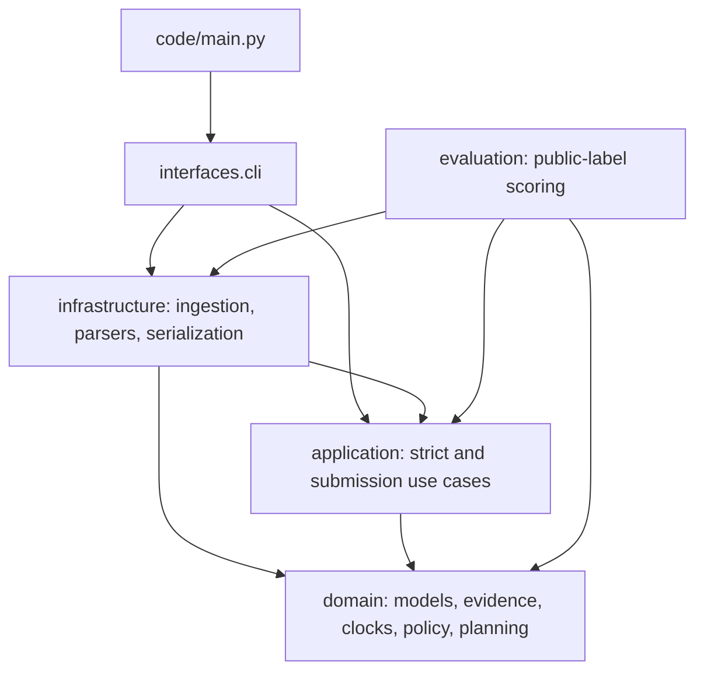

# Architecture

The package has four layers. Source imports point inward; control starts in the CLI.
The package initializers contain documentation, not compatibility re-export chains.

`domain/` has no file I/O, CLI, CSV, SQL execution or outer-layer imports. Its Pydantic
models define immutable contracts. Mutable per-run indexes and case-search state have
explicit owners. Provenance paths and locators are evidence values, not file handles.
`record_interpretation` receives the source format explicitly; the application adapter
obtains that format from provenance. The domain never infers it by opening a file.

The central domain modules are:

- `models`, `dataset`, `association_models`, `temporal_models`, `policy_models`,
  `output_contract`, `submission_models`, `diagnostic_models`: input, intermediate,
  output and uncertainty contracts. Official operation mappings are shared here.
- `identity`, `intent`, `evidence_index`, `correlation`, `workflow_attribution`:
  exact identity resolution and bounded evidence discovery. Correlation creates a
  private search context per case and expands identifiers, scoped traces, explicit
  references and terminal resource versions in that order.
- `observation_clocks`, `record_interpretation`, `state_selection`, `snapshot_coverage`:
  availability, readback meaning, physical-scope histories and explicit completeness.
- `policy`, `planning`, `citation_validation`: policy applicability, safe canonical
  plans, request coverage and citation availability/linkage.
- `snapshot_inventory`, `submission_semantics`: the submission strategy's inventory
  and inference vocabulary. Its confidence assumptions never become strict proof.

`application/` coordinates already loaded inputs. `evidence_association` creates case
bundles; `temporal_service` coordinates readback interpretation and reconstruction;
`strict_audit` applies policy, plans and validates, retaining abstentions. Abstention
and temporal diagnostics are independent of CSV serialization.

`submission_service` is a separate use case. It composes `submission.evidence`
(identifier/readback indexes), `submission.workflow` (constrained batch assignment)
and `submission.records` (fact interpretation and verdicts). Named resource assessments
replace positional mutable lists. Both strategies share genuine identity, schema,
clock, observation and output rules; they do not share confidence decisions.

`infrastructure/ingestion` loads the participant allowlist. `parsers/` handles
structured records, restricted SQLite snapshots, documents and optional local OCR.
`serialization/` handles CSV and diagnostic publication. It depends inward on typed
runs and domain validation; application services do not import those adapters.

`interfaces/cli.py` is the composition root. It parses arguments, builds in-memory
indexes and calls use cases or publication adapters. `code/main.py` preserves the
external script contract. No repository abstraction or dependency container is needed:
the workload is an in-memory batch, so plain typed inputs and composition suffice.

The evaluation package is an independent caller. Production never imports it or reads
public answer labels. The optional model adapter from earlier development is not
involved in either offline prediction path.

## Enforced contracts

`uv run lint-imports` enforces `interfaces > infrastructure > application > domain`
and forbids all production imports of `evaluation`, including indirect dependencies.
The architecture tests additionally reject cycles within a layer and prohibit domain
imports of filesystem, CLI, CSV, subprocess, PDF and SQLite libraries. Merely installing
import-linter is not the gate: both contracts and the graph tests must pass.

All domain definitions require annotations and parameterized collections; mypy checks
all runtime and evaluation modules, including bodies of remaining untyped outer-layer
callbacks. Pydantic validates raw schema values at explicit conversion boundaries.

The Clean Architecture diagnostic is **6/7 (9/10)**. Business rules are isolated,
dependencies point inward, storage is replaceable, use cases are delivery-independent,
external execution stays outside the domain, and the graph is acyclic. The composition
root criterion is partial: application services still construct their stable pure
domain collaborators. If an alternate resolver or policy implementation is introduced,
accept that collaborator in the use-case constructor and select it in the CLI. A new
interface solely to increase this score would add no current boundary value.
